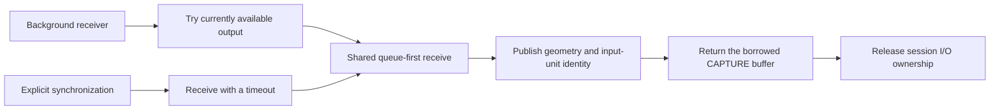

# Chrome frame delivery

Chrome HEVC playback can stall when a background receive owns the same session
I/O needed to submit more input. Pending input does not imply ready output:
a stateful decoder may require later input before releasing a reordered picture.

The previous background receive could hold this ownership for about 20 ms.
An exported target could also be recycled while its old submission remained
pending; waiting for that old output before sending the new input could produce
repeated 5000 ms waits.

## Receive ownership

`dmd_session_try_next_frame()` checks retained frames first, then calls the existing
backend with a zero poll timeout. An empty result is `DMD_ERR_TIMEOUT`, not a
fatal session error. It still processes format events.

`dmd_session_next_frame()` retains its existing explicit-wait behavior, including
using the configured timeout for nonpositive arguments. Both entry points share
queue order, format publication, frame construction and error handling.

The background receiver retains ownership through the last session operation,
including `release_frame`, so deferred destruction cannot close a borrowed
session. It yields outside ownership when it has delivered nothing. The thread
is retained to deliver completed output even without another submission.

## Historical pacing rationale

The original comments record measured tradeoffs, not arbitrary delays:

- The post-send harvest keeps its 1 ms wait. Earlier tests found that receiving
  only under input backpressure stopped at 2/6 units, while prompt harvesting
  received 6/6 or 10/10. A zero-timeout post-send harvest was insufficient in
  those tests. A former 5 ms wait cost about 3.9 ms per send; the two-submission
  path spent about 8 ms per output frame and reached only 51 fps. The 1 ms
  setting reached 120-190 fps on the tested stream with matching pixels.
- The explicit receiver keeps its 20 ms slices. The historical Firefox 140,
  1080p30 experiment using 5 ms slices barely changed mean SyncSurface latency
  (29.2 to 29.4 ms), while reported drops increased from 15.8 to 34.6 percent.
  The original comment selected 20 ms as a compromise between handling format
  events and avoiding excessive wakeups. Those measurements are specific to
  that test setup; they are not a new benchmark of the current Chrome device.
- The background receiver's former 20 ms receive supplied retry pacing too.
  This PR changes that cadence when input is pending but no output is ready.
  It avoids excluding the producer by trying once and using the existing
  2 ms no-delivery sleep outside I/O ownership. It does not preserve the old
  background retry rate or establish that the higher rate is harmless.

Faster background retries could compete for CPU on another workload or device,
even if they improve input availability here. The single-device playback result
does not invalidate the old pacing experiments or establish a cross-platform
performance or power guarantee. That tradeoff remains a review boundary.

I/O ownership also protects session lifetime. Simply clearing `io_busy` while a
blocking receive still uses the session could reintroduce the previously fixed
FD-close/use-after-free race. The background try returns before buffer release
and `io_release`; the ordinary mutex and session I/O ownership are distinct.

## Recycled targets and capacity

For exported H.264/HEVC targets, a recycled target's older pending entries retain
their input-unit identity but have a discard target. Late output still removes
exactly its matching record and returns its CAPTURE buffer. It cannot overwrite
the recycled target or fall through to an ordering guess. Non-exported reads
retain their synchronous reuse behavior.

The old reuse guard protected against late pixels overwriting a recycled target.
Its original HEVC example (two B frames) submitted surface 5 for unit 4, recycled
that surface for unit 18, and only then received the pixels for unit 4. Removing
that protection without preserving input identity could make old pixels replace
new content. Earlier blanket busy responses also broke FFmpeg/Firefox readback
reuse because reading did not reset surface state. Retaining that reason is
important: the
replacement consumes older exported units by identity while preserving the
non-exported synchronous path, rather than rejecting all reuse.

The display-wide surface object table is separate from a context's 64-entry
pending queue. Multiple decoder pools can coexist on a display without sharing
one context's object budget. Pixel buffers are still allocated on demand.

## Validation

The fix was exercised on an iQOO Pad6 Pro with Droidspaces 7.2.0, Ubuntu 26.04
arm64, Chrome 157 and an Android 16 vendor kernel. Software decoding was used
only to produce offline reference hashes; browser playback remained hardware
decoded at the selected highest quality.

- `make all`, `make check` and `make tests` pass. Receiver tests cover an empty
  nonblocking attempt, FIFO order and wraparound, a final ready frame without
  new input, format changes, release failure, repeated release, EOS, invalid
  arguments and preserved explicit-wait semantics.
- All 300 HEVC hardware frames match reference pixels and timestamps.
- Browser buffer samples match the reference for 29 HEVC and 13 H.264 frames.
- All 25 retired input records in the focused loop/seek test are consumed by
  exact identity, with no unmatched records or 5000 ms waits.
- A hardware VA-API probe creates 70 surfaces, queries object 69 and destroys
  them successfully. The old display-wide 64-slot table rejects that request.
- Background receive samples: 1718 calls, median 0.006 ms, p95 0.014 ms,
  maximum 1.645 ms. The old blocking receive had median 20.087 ms and p95 21.099 ms.
- Highest-quality 2560x1440 HEVC playback ran for 390.689 seconds: 23416 new
  frames, 18 reported drops, about 0.077 percent. The user reported smooth
  playback and requested monitoring to stop; this was not a ten-minute test.

`requestVideoFrameCallback` can miss callbacks. Its `presentedFrames` metadata
counts frames submitted for composition, so callback count alone is not a display
frame-rate measurement. In a 25-second sample, 1409 callbacks covered 1500 frames
submitted for composition and 25 seconds of media time. See the
[API proposal](https://wicg.github.io/video-rvfc/).

See [known limitations](known-limitations.md) for power and stream-end boundaries.
